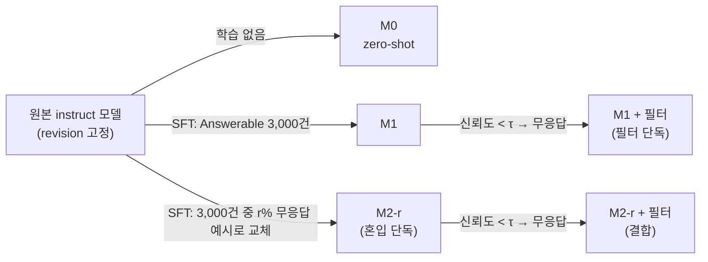

# SelectiveQA

**한국어 금융 기계독해 sLLM의 도메인 파인튜닝에 따른 무응답 행동의 소거와 복원에 관한 연구**
*Erasure and Restoration of Abstention in Domain Fine-Tuned Small LLMs: A Study on Korean Financial Machine Reading Comprehension*

서윤주 · 한양대학교 인공지능융합대학원 인공지능시스템학과 석사학위논문 (2026년 12월 제출 예정, 지도교수 김태욱)

이 저장소는 논문의 실험 코드, 가공 데이터, 예측 결과, 사전등록 문서를 담고 있습니다.

---

## 연구 요약

금융기관은 보안과 비용 때문에 7~8B 규모의 소형 언어 모델(sLLM)을 내부에 두고 도메인의 (질문, 정답) 쌍으로 지도 파인튜닝(SFT)하려 합니다. 그런데 답할 수 있는 질문만으로 파인튜닝하면, 원본 instruct 모델이 갖고 있던 무응답 행동("지문에서 확인할 수 없다")이 사라지고 근거 없는 답을 지어내는 환각이 생깁니다.

이 연구는 이 현상을 행동(무응답을 실제로 출력하는가)과 신호(답할 수 없음을 가려내는 정보가 출력 확률에 남아 있는가)로 나누어 측정하고, 이를 되살리는 두 개입을 같은 조건에서 비교합니다.

| RQ | 질문 |
|---|---|
| RQ1 | SFT는 무응답 행동과 신뢰도 신호 가운데 무엇을 소거하는가? |
| RQ2 | 무응답 예시의 혼입은 무엇을 어느 범위까지 복원하며, 정확도에 어떤 비용을 초래하는가? |
| RQ3 | 위 결과는 모델, 혼입률, 도메인에 걸쳐 어느 범위까지 일반화되는가? |
| RQ4 | 동일한 응답 비율에서 학습 시 혼입과 추론 시 신뢰도 필터 중 어느 개입이 위험률을 더 낮추며, 둘을 결합하면 개선되는가? |

### 주요 결과

- **소거와 해리 (RQ1)**: Answerable만으로 학습한 M1은 다섯 모델 15개 seed 모두에서 hard UA의 100%에 답을 지어냈습니다. 그러나 출력 답의 토큰 확률은 정답과 hard UA 환각을 AUROC 0.85~0.90으로 구분했고, 이 구분은 파인튜닝 전보다 강해졌습니다(행동–신호 해리).
- **제한적 복원 (RQ2)**: 학습 데이터의 5%를 무응답 예시로 바꾸면 easy UA 무응답은 원본 수준으로 돌아왔지만, hard UA 무응답은 원본의 27~72%에 그쳤습니다. 정확도 비용은 작았습니다(ΔEM 모델별 평균 −1.2~+0.6%p).
- **일반성 (RQ3)**: 혼입률을 30%로 올려도, 일반 도메인(KLUE-MRC)에서도 hard UA 무응답은 원본에 미치지 못했습니다.
- **개입 비교 (RQ4)**: 같은 응답 비율에서 혼입 단독과 필터 단독의 위험률은 비슷했으나 혼입은 응답 비율을 조절할 수 없었고, 둘을 결합하면 필터 단독보다 위험률이 최대 4.9%p 낮아졌습니다.

| 모델 | hard UA 무응답률(%) M0 → M1 → M2-r05 | 원본 대비 회복 비율 | ΔEM(M2−M1, %p) | 분리 AUROC (M1) | 결합의 최대 개선 폭(%p) |
|---|---|---|---|---|---|
| EXAONE-3.5-7.8B | 76.4 → 0 → 39.1 | 0.51 | −0.6 | 0.888 | 2.2 |
| Qwen3-8B | 69.7 → 0 → 39.3 | 0.56 | +0.6 | 0.872 | 4.9 |
| Llama-3.1-8B | 46.1 → 0 → 21.7 | 0.47 | −0.6 | 0.859 | 3.1 |
| Kanana-1.5-8B | 47.6 → 0 → 34.2 | 0.72 | +0.2 | 0.886 | 4.6 |
| A.X-3.1-Light | 83.5 → 0 → 22.3 | 0.27 | −1.2 | 0.876 | 2.6 |

M1·M2 값은 세 학습 seed(42, 43, 44) 평균입니다. seed별 값과 신뢰구간은 논문 부록 B를 참고하세요.

---

## 실험 설계



| 조건 | 정의 | 통제 사항 | 관련 RQ |
|---|---|---|---|
| M0 | instruct 모델의 zero-shot 추론 | 학습 없음, seed 무관 단일 결과 | RQ1, RQ2 |
| M1 | Answerable 3,000건만으로 QLoRA 파인튜닝 | 실무의 표준적 도메인 SFT 재현 | RQ1 |
| M2-r | 3,000건 중 r%(5%, 30%)를 무응답 예시로 교체해 학습 | M1과 독립적으로 원본에서 학습, 총량 고정 | RQ2~RQ4 |
| M1 + 필터 | M1의 신뢰도가 τ보다 낮은 답을 무응답으로 처리 | 추가 학습 없음, τ를 바꿔 곡선 생성 | RQ4 |
| M2-r + 필터 | M2-r에 같은 필터 적용 | 두 개입의 결합 | RQ4 |

---

## 데이터

AI Hub의 **금융·법률 문서 기계독해 데이터(금융 파트)**와 **숫자연산 기계독해 데이터**로 한국어 금융 MRC를 구축했습니다. 질문 유형은 text span, table lookup, numerical reasoning, yes/no의 네 가지입니다. 같은 문서가 학습과 평가에 함께 나타나지 않도록 문서 단위로 분할했습니다.

| 세트 | 건수 | 파일 |
|---|---|---|
| 학습 (M1) | Answerable 3,000 | `data/processed/train.jsonl` |
| 학습 (M2-r05 / M2-r30) | 3,000 (무응답 예시 150 / 900) | `train_mix_r05.jsonl`, `train_mix_r30.jsonl` |
| 평가 | 1,767 (Answerable 1,200, easy UA 300, hard UA 267) | `eval_full_v2.jsonl` |
| 평가 (검색 불일치형 UA) | 107 | `eval_natua.jsonl` |
| 일반 도메인 (KLUE-MRC) | 학습 3,000 / 평가 1,767 | `klue_train.jsonl`, `klue_train_mix_r05.jsonl`, `klue_eval_full.jsonl` |

평가셋 가운데 정답 필드에 수치 대신 지문의 문장이 들어가 채점이 성립하지 않는 30건을 제외하여 유효 표본은 **1,737건**입니다. 제외 목록은 `results/excluded_gold_v2.json`(24건)과 `results/excluded_gold_v2_manual.json`(6건)에 고정되어 있습니다.

### 답할 수 없는 문항(UA)의 종류

| 종류 | 건수 | 구축 방식 | 생성 코드 |
|---|---|---|---|
| easy UA | 300 | 질문에 다른 문서의 지문을 무작위로 붙임(교차 지문) | `prepare_data.py` |
| hard UA · 근거 제거형 | 181 | 원 지문에서 정답의 근거 문장만 삭제 | `make_hard_unanswerable.py` |
| hard UA · 대상 치환형 | 86 | 질문의 연도·월·개체를 지문에 없는 것으로 치환 | `make_hard_unanswerable.py` |
| 검색 불일치형 UA (retrieval-mismatch UA) | 107 | 같은 유형의 다른 문서 중 주제가 가장 비슷하면서 정답이 없는 지문과 매칭(무편집) | `make_natural_ua.py` |

hard UA는 규칙으로 278건을 생성한 뒤 전건 수동 검수하여 11건을 폐기했습니다(`results/hard_ua_discards.json`, `apply_discards.py`). 학습에 혼입하는 무응답 예시는 easy UA와 같은 교차 지문 방식으로 학습셋 문서에서 별도 구성했으므로, hard UA에서의 복원은 학습 시 보지 못한 형태로의 일반화를 검증합니다. 혼입 세트는 r05 ⊂ r30의 포함 관계를 갖고, 겹치는 문항에는 같은 교차 지문을 배정했습니다(`make_train_mix.py`, `train_mix_manifest.json`).

### question_id 규약

평가 코드는 question_id로 문항 종류를 구분합니다.

| 패턴 | 의미 |
|---|---|
| `unans_` 로 시작 | easy UA |
| `-hd-er` 포함 | hard UA (근거 제거형) |
| `-hd-ts` 포함 | hard UA (대상 치환형) |
| `-trainua` 접미 | 학습용 무응답 예시 |

### 입력과 출력 형식

입력은 `src/inference/prompts.py`의 `build_messages()`가 만드는 `[지문] … [질문] …` 형식이고, 모델은 다음 두 형식 중 하나의 JSON을 출력합니다.

```jsonc
// 응답(Answerable) 형식
{"answerable": true, "answer": "<정답>", "evidence_span": "<정답>"}
// 무응답(Unanswerable) 형식
{"answerable": false, "answer": null, "evidence_span": null}
```

`evidence_span`은 근거 문장을 담도록 설계한 필드이나, 학습 데이터에 근거 문장 주석이 없어 학습 정답에서는 `answer`와 같은 값을 씁니다(`build_target()`). 채점과 신뢰도 계산에는 `answerable`과 `answer`만 사용합니다.

> AI Hub 원천 데이터(`data/raw/`)는 저장소에 포함되어 있지 않습니다. 원천 데이터부터 재구축하려면 AI Hub에서 두 데이터셋을 내려받아 `config.yaml`의 `paths.raw_finance_dir`, `paths.raw_numeric_dir`에 두세요. 데이터 이용 조건은 AI Hub 약관을 따릅니다.

---

## 모델

| 약칭 | Hugging Face 모델 | revision | 설정 파일 | 결과 폴더 |
|---|---|---|---|---|
| EXAONE | `LGAI-EXAONE/EXAONE-3.5-7.8B-Instruct` | `0ff6b5ec7c13` | `config_abl_exaone_outproj.yaml` | `results/exaone_outproj/` |
| Qwen3 | `Qwen/Qwen3-8B` (non-thinking) | `b968826d9c46…` | `config_qwen3.yaml` | `results/qwen3/` |
| Llama | `meta-llama/Llama-3.1-8B-Instruct` | `0e9e39f249a1…` | `config_llama.yaml` | `results/llama/` |
| Kanana | `kakaocorp/kanana-1.5-8b-instruct-2505` | `c963a5f4f649…` | `config_kanana.yaml` | `results/kanana/` |
| A.X | `skt/A.X-3.1-Light` | `9b41bb240647…` | `config_ax31.yaml` | `results/ax31/` |
| EXAONE (KLUE-MRC) | 위와 같음 | `0ff6b5ec7c13` | `config_klue_exaone_outproj.yaml` | `results/klue_exaone_outproj/` |

전체 revision 해시는 각 설정 파일에 있습니다.

> **EXAONE 결과는 `results/exaone_outproj/`(파일명 `_pin`)가 최종본입니다.** 공통 LoRA 설정의 대상 모듈 이름(`o_proj`)이 EXAONE의 attention 출력층 이름(`out_proj`)과 달라 원 실험에서는 어댑터가 q/k/v에만 적용되었습니다. 사전등록 절차에 따라 `q_proj, k_proj, v_proj, out_proj`로 재학습했으며(`prereg_exaone_outproj_261002.md`), `results/` 최상위의 EXAONE 예측 파일은 원 실험 기록으로 보존한 것입니다(논문 부록 A).

### 학습·추론 설정

| 항목 | 값 |
|---|---|
| 방법 | QLoRA (4-bit NF4) |
| LoRA | r = 16, α = 32, dropout = 0.05, attention 4개 투영층(q, k, v, o/out) |
| 최적화 | 학습률 2 × 10⁻⁴, 배치 1 × 누적 16 (실효 16), 2 epoch (376 step), max_seq_len 2048 |
| 학습 seed | 42, 43, 44 |
| 추론 | greedy 디코딩, max_new_tokens = 128 (M0는 seed와 무관한 단일 결과) |
| 신뢰도 | `answer` 구간 토큰 확률의 기하평균 |
| 하드웨어 | Modal 클라우드, NVIDIA L4 GPU 1장 |
| 라이브러리 | torch 2.8.0, transformers 4.57.1, peft 0.20.0, accelerate 1.14.0, bitsandbytes 0.50.0 (`results/env_versions.txt`) |

`train_qlora.py`는 학습 시작 전에 LoRA가 모든 층의 대상 모듈에 적용되었는지 검사하고(`check_lora_coverage`), 맞지 않으면 중단합니다.

---

## 평가 지표와 사전등록 판정

| 지표 | 정의 |
|---|---|
| UA 무응답률·환각률 | `answerable`이 false면 무응답. easy UA와 hard UA는 항상 나누어 보고 |
| 분리 AUROC | M1이 맞힌 Answerable 문항과 M1이 지어낸 hard UA 답을 신뢰도로 구분하는 AUROC |
| 복원 비용 | 같은 seed의 M2-r과 M1 사이 Answerable EM 차이(ΔEM), 허위 무응답률, 응답 길이 배율, ΔECE |
| 응답 비율·위험률 | 응답 비율(coverage)을 맞춘 뒤 위험률(risk, UA 환각과 Answerable 오답 포함)을 비교 |

신뢰구간은 stratified paired bootstrap(10,000회)의 95% 구간입니다. 가설과 판정 기준은 결과를 확인하기 전에 고정했고(논문 표 3-4), 세 seed 모두 충족하면 강건 채택(3/3), 두 seed면 조건부 채택(2/3)입니다.

| 가설 | RQ | 질문 | 판정 기준 (seed별) |
|---|---|---|---|
| H1 | RQ2 | 혼입하면 UA 환각이 줄어드는가? | easy·hard 각각 M2 환각률 CI 상한 < M1 CI 하한 |
| H2 | RQ2 | Answerable 정확도가 유지되는가? | ΔEM(M2 − M1) CI 하한 > −3%p |
| H3 | RQ1 | M1의 출력 확률이 정답과 hard UA 환각을 구분하는가? | 분리 AUROC CI 하한 > 0.85 |
| H4 | RQ4 | 되살아난 무응답이 M1의 신뢰도가 낮은 문항에 몰리는가? | 무응답 정렬 AUROC CI 하한 > 0.75 (탐색적) |
| H5 | RQ2 | 혼입 후에도 보정이 원본보다 나은가? | 네 유형 모두 ΔECE(M2 − M0) CI 상한 < 0 |

### 사전등록 문서

| 문서 | 내용 |
|---|---|
| `docs/prereg_grid_r30_260908.md` | 혼입률 격자(r05 → r30) 판정 기준 |
| `docs/prereg_stageE_kanana_260909.md` | Kanana-1.5-8B 일반화 |
| `docs/prereg_phase2_klue_260920.md` | KLUE-MRC 도메인 축 분리 |
| `docs/prereg_tier1_260924.md`, `docs/prereg_tier1_addendum_qwen3_260926.md` | 학습 중 UA/Answerable loss 분리 진단 |
| `docs/prereg_stage1_ablation.md` | 무응답 타깃 형식·학습률 절제 |
| `prereg_stageF_ax31_260929.md` | A.X-3.1-Light 투입 |
| `prereg_exaone_outproj_261002.md` | EXAONE LoRA 대상 모듈 수정 재학습 |
| `prereg_grid_r30_exaone_outproj_261003.md` | EXAONE(out_proj) 혼입률 격자 |
| `prereg_klue_m1_outproj_261004.md`, `prereg_klue_m2_r05_outproj_261010.md` | KLUE-MRC EXAONE M1·M2-r05 재학습 |
| `prereg_bos_check_261011.md` | 추론 입력 BOS 중복 점검 (Kanana, Llama) |

### 사전등록 이탈 (논문 부록 A 요약)

| # | 이탈 | 처리 |
|---|---|---|
| 1 | EXAONE의 LoRA가 출력층(out_proj)에 적용되지 않음 | 판정 기준 사전등록 후 q·k·v·out_proj로 재학습, 본 분석 교체 |
| 2 | 학습 라이브러리 버전이 모델·시점에 따라 다름 | EXAONE 재학습·KLUE는 원 실험 버전으로 고정(`modal_train_pinned.py`) |
| 3 | H4의 신호 정의 변경 | M1 신뢰도를 뒤집은 값으로 변경, H4는 탐색적 관찰로 격하 |
| 4 | 혼입량 판정 기준의 커밋 누락 | 사전 지정 탐색적 판정으로 표기 |
| 5 | Kanana·A.X의 추가 목적 변화 | 사전등록 범위(M0·M1·M2-r05, H1~H5)까지만 보고 |
| 6 | 제외 목록 표시 오류, 추가 불량 정답 5건 | 판정은 30건 제외 그대로, 5건은 민감도 분석 |
| 7 | RQ4 비교 구간의 도달 규칙 | 부트스트랩 표본의 95% 이상에서 두 구성이 모두 도달한 응답 비율만 비교 |

---

## 저장소 구조

```
├── config*.yaml                  # 모델·실험별 설정 (아래 '모델' 표 참고)
├── modal_train.py                # Modal L4에서 train_qlora.py 실행
├── modal_train_pinned.py         # 원 실험 라이브러리 버전으로 고정한 학습 (EXAONE 재학습, KLUE)
├── modal_inference.py            # Modal L4에서 run_inference.py 실행
├── modal_eval.py                 # Modal CPU에서 evaluate_followup.py 실행
├── modal_diag_tier0.py, modal_train_diag.py, modal_ckpt_eval.py   # 진단 실험
├── prereg_*.md, docs/            # 사전등록 문서
├── data/processed/               # 가공 데이터 (원천 data/raw/ 는 미포함)
├── src/
│   ├── data_prep/                # 데이터 구축 (AI Hub 변환, UA 생성, 혼입 세트, KLUE)
│   ├── training/train_qlora.py   # QLoRA 학습
│   ├── inference/                # prompts.py (프롬프트·정답 형식·파싱), run_inference.py
│   ├── evaluation/               # evaluate_followup.py (H1~H5, risk–coverage), compare_ratio.py
│   ├── analysis/                 # 표 칸 산출, 민감도·진단 분석
│   └── plotting/
└── results/
    ├── exaone_outproj/ qwen3/ llama/ kanana/ ax31/ klue_exaone_outproj/   # 모델별 최종 결과
    ├── excluded_gold_v2*.json, hard_ua_discards.json                       # 제외·폐기 목록
    └── env_versions.txt                                                    # 학습 환경 기록
```

결과 파일 이름은 `preds_{조건}_{태그}_s{seed}.jsonl` 규칙을 따릅니다. 예: `preds_M1_v2_s42.jsonl`, `preds_M2_r05_s43.jsonl`, `preds_M1_natua_s44.jsonl`(검색 불일치형 UA), EXAONE 재학습분은 `preds_M1_pin_s42.jsonl`처럼 `_pin`이 붙습니다.

---

## 재현 방법

학습과 추론은 [Modal](https://modal.com) 클라우드의 L4 GPU에서 실행했습니다. 평가와 표 산출은 로컬 CPU에서 돌아갑니다.

### 0. 환경

```bash
python -m venv .venv && source .venv/bin/activate
pip install torch==2.8.0 transformers==4.57.1 peft==0.20.0 accelerate==1.14.0 bitsandbytes==0.50.0 \
            pyyaml numpy matplotlib tqdm safetensors sentencepiece modal
modal setup                                   # Modal 계정 연결
modal secret create huggingface HF_TOKEN=...  # Llama 등 접근 제한 모델용
```

`requirements.txt`는 최소 버전만 지정합니다. **transformers 5.x에서는 EXAONE-3.5의 원격 코드가 동작하지 않으므로**(학습 loss가 약 8배로 나옴) 위 버전을 고정하세요. Modal 래퍼는 결과를 `selectiveqa-results` 볼륨에, 모델 캐시를 `hf-cache` 볼륨에 저장합니다.

### 1. 데이터 (가공 데이터가 이미 `data/processed/`에 있으면 생략)

```bash
python src/data_prep/prepare_data.py --inspect     # AI Hub 원천 스키마 확인
python src/data_prep/prepare_data.py               # train.jsonl / eval.jsonl (+ easy UA)
python src/data_prep/make_hard_unanswerable.py     # hard UA 생성 (--pilot, --review-sample 로 검수 표본 추출) → 수동 검수
python src/data_prep/apply_discards.py             # 검수 폐기 반영 → hard_ua_final.jsonl
python src/data_prep/make_eval_sets.py             # eval_full_v2.jsonl 등 평가 파일 파생
python src/data_prep/make_natural_ua.py            # 검색 불일치형 UA 후보 → 전수 검수 → --finalize
python src/data_prep/make_train_mix.py             # train_mix_r05/r10/r30.jsonl
python src/data_prep/prepare_klue.py --klue-dir <KLUE-MRC 경로>   # KLUE-MRC 세트
```

### 2. 학습 (모델별 설정 파일만 바꿔 실행)

```bash
# M1 (Answerable만)
modal run --detach modal_train.py --train-file train.jsonl --tag "" --seed 42 --config config_qwen3.yaml
# M2-r05 / M2-r30
modal run --detach modal_train.py --train-file train_mix_r05.jsonl --tag _r05 --seed 42 --config config_qwen3.yaml
# EXAONE 재학습 (버전 고정)
modal run --detach modal_train_pinned.py --train-file train.jsonl --tag _pin --seed 42 --config config_abl_exaone_outproj.yaml
```

seed 43, 44도 같은 방식으로 실행합니다.

### 3. 추론

```bash
# M0 (학습 없음)
modal run --detach modal_inference.py --condition M0 --out-tag M0_v2 --eval-file eval_full_v2.jsonl --config config_qwen3.yaml
# M1 / M2 (어댑터 지정)
modal run --detach modal_inference.py --condition M1 --adapter-dir results/qwen3/qlora_adapter_s42 \
          --out-tag M1_v2_s42 --eval-file eval_full_v2.jsonl --config config_qwen3.yaml
# 검색 불일치형 UA
modal run --detach modal_inference.py --condition M1 --adapter-dir results/qwen3/qlora_adapter_s42 \
          --out-tag M1_natua_s42 --eval-file eval_natua.jsonl --config config_qwen3.yaml
# 결과 회수
modal volume get selectiveqa-results <파일명> ./results/qwen3
```

추론은 중단되어도 같은 명령으로 이어서 실행됩니다(이미 있는 question_id는 건너뜀). 처음부터 다시 돌리려면 `--fresh`를 붙입니다.

### 4. 평가와 표 산출 (CPU)

```bash
# H1~H5 판정 + risk–coverage (r05)
python src/evaluation/evaluate_followup.py --config config_qwen3.yaml --tag r05
# 혼입률 격자 (r05 → r30)
python src/evaluation/compare_ratio.py --config config_qwen3.yaml --tag-a r05 --tag-b r30
# 4장 표의 모델별 칸
python src/analysis/model_cells.py --config config_qwen3.yaml
# 검색 불일치형 UA 등 보충 지표
python src/analysis/fill_gaps.py --config config_qwen3.yaml

# EXAONE (재학습분, 파일명 _pin)
python src/evaluation/evaluate_followup.py --config config_abl_exaone_outproj.yaml \
       --m1-glob "preds_M1_pin_s*.jsonl" --m2-glob "preds_M2_r05_pin_s*.jsonl" --tag outproj_pin
# KLUE-MRC M2-r05 복원·비용
python src/analysis/klue_m2_check.py --metrics <metrics_followup_*.json> \
       --m0 <preds_M0> --m1-glob "<M1 glob>" --m2-glob "<M2 glob>"
```

부트스트랩 10,000회는 오래 걸립니다. 예비 확인에는 `--n-boot 1000`을 쓰거나, `modal_eval.py`로 Modal CPU에서 실행하세요.

### 새 모델을 추가할 때

```bash
python src/analysis/preflight_tokenizer.py --config config_<model>.yaml   # 프롬프트 렌더링·BOS 중복·학습/추론 토큰열 일치 점검
python src/data_prep/check_seq_len.py --config config_<model>.yaml        # max_seq_len 초과 문항 확인
```

---

## 논문 본문 밖의 탐색·진단 실험

다음은 실험 과정에서 수행한 진단과 절제 실험이며, 논문의 주 판정에는 쓰이지 않았습니다.

- **혼입률 r01·r10** (`train_mix_r01.jsonl`, `train_mix_r10.jsonl`): 초기 EXAONE 격자 탐색
- **무응답 타깃 형식·학습률 절제** (`config_abl_filled.yaml`, `config_abl_lr1e4.yaml`, `docs/prereg_stage1_ablation.md`)
- **Tier 0 진단** (`modal_diag_tier0.py`): 타깃 NLL 비교, LoRA ΔW 코사인 유사도, 어댑터 보간, 프롬프트 절제
- **Tier 1 진단** (`modal_train_diag.py`, `modal_ckpt_eval.py`): 학습 중 UA/Answerable loss 분리, step별 체크포인트 평가
- **BOS 중복 점검** (`prereg_bos_check_261011.md`, `run_inference.py --dedupe-bos`): Kanana·Llama의 추론 입력 BOS 중복이 판정에 미치는 영향 확인 (기본값은 꺼짐)
- **민감도 분석**: yes/no 재채점(`sensitivity_yesno.py`, `rescore_yesno_diff.py`), 손상 정답 제외(`sensitivity_goldlen.py`), 추가 불량 정답 5건 제외(`results/kanana/metrics_followup_r05_ex35.json`)

---

## 인용

```bibtex
@mastersthesis{seo2026selectiveqa,
  author = {서윤주},
  title  = {한국어 금융 기계독해 sLLM의 도메인 파인튜닝에 따른 무응답 행동의 소거와 복원에 관한 연구},
  school = {한양대학교 인공지능융합대학원},
  year   = {2026},
  note   = {석사학위논문}
}
```
